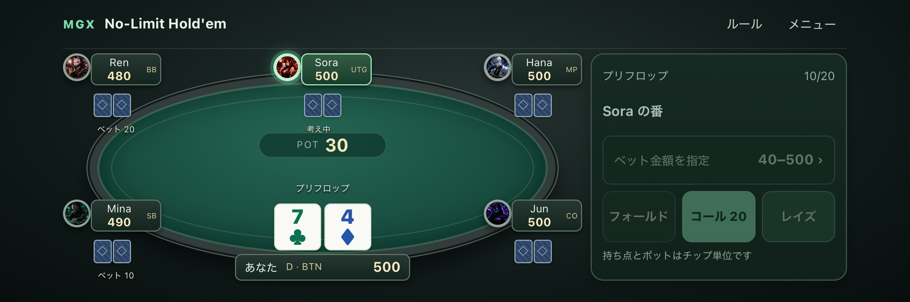
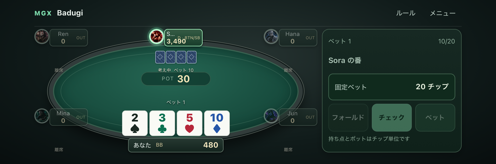
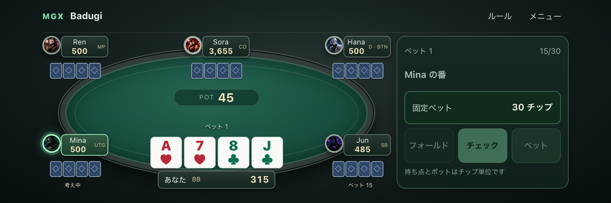
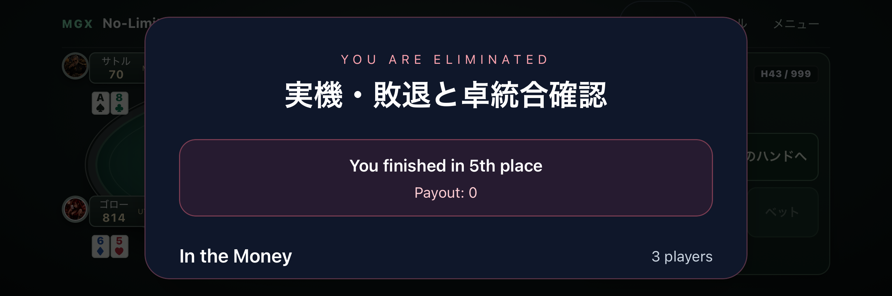

# 相手アイコン・敗退・卓統合の修正と確認

2026-09-23。対象は `codex/mgx-learning-entry` のローカルビルド。本番への反映は行っていない。

## 原因と修正

|問題|修正|
|相手の作成済み画像が丸テーブルで表示されない|画像ファイルは削除されていない。モバイル共通席が汎用アイコンだけを描画していたため、既存の画像URL・CPUキャラクターを参照する表示へ修正。読込失敗時だけ代替アイコンにする。|
|モバイルで相手の敗退履歴を開けない|共通ヘッダーに「敗退」を追加。席移動・卓統合後も大会の参加者台帳から氏名と順位を表示。未決着のオールインは敗退扱いしない。|
|キャッシュで敗退した相手の状態が分かりにくい|「離席」と表示し、カードを配らない。フォールドや未決着オールインと区別。|
|離席CPUが規定の10ハンド後も復帰しない|新しいハンドの生成時に失われていた敗退時点とリバイ額を保持。10ハンド後の再着席と画像復帰まで確認。|
|卓統合時にユーザー席が別卓扱いになり、裏側のCPU進行の対象になりうる|実際のユーザーID `hero-player` を認識。ユーザーの卓を保持してCPU専用の背景進行から除外。|
|敗退・大会終了の画面がハンド結果に隠れる|大会の終了表示を優先し、通常のハンド結果との同時表示を抑止。|
|ブラインド支払いで全員オールインすると進まない|NLH・FLH・PLO・PLO8で操作可能な席がなければボードを最後まで配り決着。重複精算を防止。|
|初回配牌で即決着すると大会に結果が届かない|ハンドIDと履歴の初期化後に決着したコントローラーの結果を同期。|
|Badugiで次のハンドの操作が無効になる／チップが消える|新しい配牌を両方の状態管理へ同期し、前のハンドの結果・フォールド状態を持ち越さない。|
|決着後の自動進行で画面が消える|完了済みハンドに自動CPU操作・ラウンド進行を再実行しない。|
|Badugiのドロー後に操作画面と内部状態がずれる／2回で終了する|大会でも同じコントローラーでラウンド完了を処理し、数え方が異なる旧処理と混在させない。3回のドローと最終ベットを通した回帰確認を追加。|
|Badugiで短いスタックのオールイン勝者がサイドポットまで獲得する|既存のサイドポット対応エンジンで精算。50・100・100チップを出した3人で、最短スタックが勝った場合の配分150・100・0を検証。|

## 確認方法と範囲

- 物理端末：USB接続されたiPhone 16、iOS 26.5.2、Safari。横向き852×283 CSS px。ローカル検証サーバーへ接続。
- 端末上のSafariを遠隔検査し、表示され有効なボタンをDOM経由で操作した。今回の指でのタップ試験とは区別する。
- トーナメントは18人・500チップ・3卓・低い固定ブラインドで開始。勝敗や脱落者の強制変更なし。最終卓まではユーザーをフォールド、最終卓では合法的なレイズ等で継続。
- 各ハンドの確定後に、9000チップの保存、着席IDの一意性、残人数、敗退者のゼロスタックと順位、ユーザー卓の維持を検査。
- 相手の別卓は製品実装のCPU簡易シミュレーション。全卓の全アクションを詳細エンジンで再現した試験ではない。
- ブラウザー試験：1440×900、393×695、852×283。画面例外がないことも検査。
- キャッシュの離席試験は敗退直後の制御された状態から開始し、その後の10ハンドを実際のボタンで進行。

## 結果

|確認|結果|証拠・範囲|
|既存画像の保全|PASS|`public/characters/` の20 PNG（CPU18人・Hero・Dealer）を保全。今回の画像削除なし。|
|実機・相手5人の画像読込と表示|PASS|`portraits-restored.png`。丸い枠内への表示を目視。|
|実機・NLH 18人、3→2→1卓、敗退、復帰|PASS|27ハンド後、28ハンド目に5位で敗退。18人の順位、総チップ9000、賞金合計、メニュー復帰を確認。|
|実機・Badugi 18人、3→2→1卓、敗退、復帰|途中版でPASS／最終版再確認待ち|40ハンド後、41ハンド目に5位で敗退。`physical-badugi-before-round-counter-fix.json`。その後見つかったラウンド数・サイドポット修正は下記自動試験で確認。最後の実機再試験時にUSB接続が消失。|
|実機・キャッシュCPUの離席→再着席|PASS|離席中9ハンドは0チップ・手札なし、10ハンド目に持ち点・4枚の手札・画像が復帰。`physical-cash-reseat.json`。|
|モバイル画像・敗退欄、大会の卓統合・保存、ボード種目のブラインドオールイン|65テストPASS|14ファイル。卓統合後の再保存・復元、一意な着席、順位・賞金・チップ保持も検査。|
|Badugiの状態境界・ラウンド数・サイドポットと既存コントローラー|26テストPASS|短いオールインの誤った全額獲得を修正前に再現し、修正後150・100・0を確認。|
|全種目のゲーム進行回帰|173 PASS、1 skip|既存のOFC対象外ケース1件。|
|既知不具合回帰|47 PASS|既存の進行不具合検出ゲート。|
|RL安全性|56 PASS|観測・モデル連携の既存安全性ゲート。|
|ブラウザー・表示と連続操作|10 PASS|3画面サイズの終了表示、例外なし、キャッシュ復帰、敗退欄、Badugi次ハンドと3ドロー。|
|終了時に画面が消えるケースの反復|3回連続PASS|PC幅・ブラインド即オールインの再現条件。|
|ビルド|PASS|既存のチャンクサイズ警告あり。|

最終版のブラウザーでも18人大会の連続確認に成功。41ハンドの確定後、次のハンドで敗退／終了に到達し、3→2→1卓、9000チップの保存、18人分の重複のない順位、画面例外なし、メニュー復帰を確認した。証拠は `browser-badugi-merge.json`。実行時間は約5分20秒。

**残る確認は、最終版のBadugiをiPhoneで再実行すること。** USB端末一覧が空になり、Web Inspector接続も切れたため、再接続を依頼済み。これを実機PASSには含めない。

## 保存した証拠

- `physical-nlh.json`：18人大会のハンドごとの状態、卓統合イベント、最終順位・賞金。
- `physical-badugi.json`：最終再試験の接続中断記録。途中版の完走は `physical-badugi-before-round-counter-fix.json`。
- `physical-cash-reseat.json`：離席から10ハンド後の復帰。
- `browser-badugi-merge.json`：最終版の18人大会の連続確認、残人数・卓数・チップ・最終順位。
- `*-before-*.json`：修正前に再現した不具合。最終結果と混同しない。
- 再実行用：`reports/gameplay-device/physical-bust-merge.mjs`、`physical-cash-reseat.mjs`。

## 未確認・対象外

- 今回、全26種目それぞれについて実機で大会完走したわけではない。実機の連続進行はNLH・Badugiを対象とし、共通の卓統合・順位・賞金は自動試験でも検証。
- 縦向きはブラウザーで確認。今回の実機試験は横向き。
- 課金・本番のオンライン対戦・外部決済は対象外。

## 画面例

